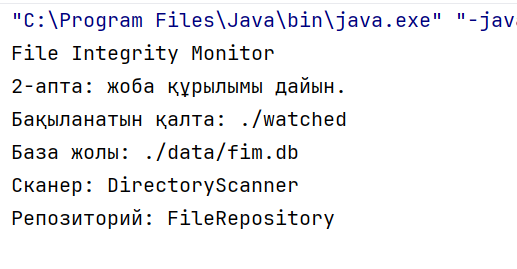

# File Integrity Monitor — 3-апта

Java 17 оқу жобасы: файлдардың SHA-256 хэштерін есептеу, SQLite-те сенімді бастапқы күйді сақтау және файл өзгерістерін бақылау.

## Не қосылды

- Блоктармен SHA-256 есептеу, ішкі қалталарды сканерлеу.
- SQLite: baseline_files, fim_metadata, fim_events кестелері; PreparedStatement.
- CREATED, MODIFIED, DELETED оқиғаларын анықтау.
- WatchService, 300 мс debounce және шамамен 1 секунд сайын толық салыстыру.
- Консольдік ескерту, мәтіндік журнал және базаға оқиға жазу.
- Properties баптаулары, init/check/watch командалары, автоматты тесттер.

## IntelliJ IDEA арқылы бастау

1. Архивті жаңа қалтаға шығарыңыз. Бұрынғы жобаңызды сақтап қойыңыз.
2. IntelliJ → Open → осы жобаның pom.xml файлын таңдаңыз.
3. JDK 17 немесе жаңасын Project SDK ретінде таңдаңыз. Maven тәуелділіктерін жүктеңіз.
4. Жоба түбірінде watched қалтасын жасап, ішіне demo.txt файлын салыңыз.
5. Main үшін Run → Edit Configurations → Program arguments ішіне **init** жазыңыз. Working directory — pom.xml тұрған жоба түбірі.
6. Main-ді іске қосыңыз: «Baseline saved» шығады. init тек бір рет орындалады.
7. Program arguments мәнін **watch** деп өзгертіп, қайта іске қосыңыз.
8. demo.txt мәтінін өзгертіп сақтаңыз; жаңа файл қосыңыз; тек сынақ файлын жойыңыз. Консольде тиісті оқиғалар шығады.
9. Қызыл Stop батырмасымен бақылауды тоқтатыңыз. Тек бір рет тексеру үшін **check** пайдаланыңыз.

Аргументсіз Main тек анықтама шығарады — бақылау басталмайды.

## Maven және командалық жол

JDK 17+ және Maven қажет. Терминалды жоба түбірінде ашыңыз:

```bash
mvn test
mvn package
java -jar target/file-integrity-monitor-1.0-SNAPSHOT.jar init
java -jar target/file-integrity-monitor-1.0-SNAPSHOT.jar check
java -jar target/file-integrity-monitor-1.0-SNAPSHOT.jar watch
```

Қалтаны алдын ала өзіңіз жасаңыз. Бақыланатын файлды бағдарлама өзгертпейді.
Shade plugin тәуелділіктерді JAR-ға жинауға бапталған. Осы ортада Maven/JDK компиляторы жоқ болғандықтан Maven жинағы бөлек тексерілген жоқ; Java коды Java 17 деңгейінде Eclipse компиляторымен және JUnit Console арқылы тексерілді.

Басқа жолдарды беру мысалы (бос орын болса тырнақша қолданыңыз):

```bash
java -jar target/file-integrity-monitor-1.0-SNAPSHOT.jar init "C:/fim-demo/watched" "C:/fim-demo/data/fim.db" "C:/fim-demo/logs/events.log"
```

Реті: команда, қалта, база, журнал. check/watch үшін де дәл сол жолдарды беріңіз.

## Баптау

Әдепкі мәндер src/main/resources/application.properties файлынан оқылады:

```properties
monitor.directory=./watched
database.path=./data/fim.db
log.path=./logs/events.log
```

Аргументтер properties мәндерінен басым. Properties файлын өзгерткен соң қайта жинаңыз.
База мен журнал бақыланатын қалтадан тыс орналасуы тиіс. Жоқ output қалталары автоматты жасалады.

## Қолдану нәтижесі

Төмендегі мәтін — мысал, жолдар мен сан файлдарыңызға байланысты:

```text
Baseline saved: 1 files
Baseline differences: 0
Watching: .../watched (Ctrl+C to stop)
... MODIFIED .../watched/demo.txt old=... new=...
```

init сенімді күйді бір рет сақтайды. Қайта init жасау бар baseline-ды ауыстырмайды және қате береді.
check әр жолы дисктегі күйді сенімді базамен салыстырады.
watch алдымен baseline айырмашылықтарын шығарып, кейін алдыңғы жедел snapshot-пен салыстырады.
Жедел snapshot тек жадта жаңарады, сенімді база өзгермейді. Сондықтан watch қайта басталғанда бұрынғы baseline айырмашылықтары қайта хабарлануы қалыпты.
Жаңадан сенімді күй қабылдау керек болса, файлдарды қолмен тексеріп, басқа жаңа база жолымен init орындаңыз; ескі базаны сақтаңыз.

## Тексеру

src/test/java/kz/edu/fim/FimTest.java: хэштердің белгілі мәндері, бос/жоқ файл,
рекурсивті сканер, оқиға түрлері, журнал, SQLite, baseline ауыстырудан қорғау,
output жолдарын тексеру, CLI және нақты WatchService CREATE/MODIFY/DELETE сценарийі.
MainTest аргументсіз анықтаманы тексереді.
Нақты тексеру нәтижесі: docs/TEST-RESULTS.md.

## Қауіпсіздік және шектеулер

- Оқу MVP-і; антивирус емес, өзгерісті тоқтатпайды және файлды қалпына келтірмейді.
- Тек рұқсат берілген сынақ қалталарын пайдаланыңыз.
- Базаны/журналды қорғаңыз; шабуылшы baseline-ды өзгертсе, бақылау сенімсіз.
- Файл мазмұны журналға жазылмайды; жолдар мен хэштер де сезімтал болуы мүмкін.
- База, журнал, watched және target GitHub-қа жүктелмеуі тиіс (.gitignore қосылған).
- Символдық сілтемелер сканерленбейді. Жолдарды іске қосылғаннан кейін қасақана ауыстыруға қарсы толық sandbox қорғанысы жоқ.
- Әр цикл толық хэштеу жасайды: үлкен каталогтарға тиімді емес. Қысқа уақытта пайда болып, қайта жоғалған уақытша өзгерістер өткізіліп кетуі мүмкін.
- Оқу қатесінде алдыңғы snapshot сақталады, қате stderr-ге шығады. Ішінара scan «файл жойылды» деп қабылданбайды.
- Файл өлшемі/уақыты/идентификаторы бойынша оқу тұрақтылығы тексеріледі, бірақ бұл атомарлық filesystem snapshot емес.
- Базаға оқиға жазу мен мәтіндік журнал бір ортақ транзакция емес; журнал қатесінде бағдарлама тоқтайды, базаға жазба түсуі мүмкін.
- Тесттер Linux-та тексерілді; Windows-та IntelliJ арқылы сынап шығыңыз.

## Құжаттар және скриншот

Research: docs/research.md. Бұрынғы UML: docs/uml. Олардың «қаңқа/жоспар» белгілері екінші аптаның тарихи күйін көрсетеді; жаңа CLI, compareAll және watcher snapshot логикасы бұл диаграммаларда толық көрсетілмеген.

Төмендегі нақты скриншот **екінші аптаға** тиесілі, қазіргі мониторингтің дәлелі емес:



Үшінші аптаға жаңа скриншотты өз компьютеріңізде watch іске қосып, demo.txt өзгерткен соң түсіріңіз.
Лицензия: LICENSE.
