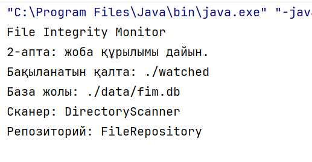

# File Integrity Monitor

Java тіліндегі файл тұтастығын бақылау оқу жобасы. **Қазіргі кезең: зерттеу және бағдарламаның құрылымы дайын. Нақты мониторинг әлі іске асырылмаған.**

## Мақсаты

Маңызды файлдардың қосылғанын, өзгергенін немесе жойылғанын анықтап, пайдаланушыға хабарлау. Жоспар бойынша файлдың SHA-256 хэші сенімді бастапқы хэшпен салыстырылады, файл күйлері SQLite базасында, оқиғалар журналда сақталады.

Мысал: сайттың конфигурация файлы байқалмай өзгерсе, FIM айырмашылықты анықтап, ескерту береді. Өзгерістің заңды не зиянды екенін пайдаланушы бағалайды.

## Жобаның қазіргі күйі

| Дайын | Кейін іске асырылады |
| --- | --- |
| Research, талаптар және архитектура жоспары | SHA-256 есептеу және каталогты сканерлеу |
| Пакеттер, модельдер, әдіс қаңқалары | WatchService арқылы бақылау |
| Main ішінде объектілерді құру және консольге шығару | SQLite қосылымы, сақтау және салыстыру |
| application.properties файлы | Баптауларды файлдан оқу, журнал және ескерту |

`UnsupportedOperationException` тастайтын әдістер — іске асырылмаған қаңқалар. `Main` оларды шақырмайды. Main іске қосылғаны тесттердің өткенін немесе мониторинг жұмыс істейтінін білдірмейді.

## Технологиялар

Java 17, Maven, Java WatchService, MessageDigest SHA-256, SQLite JDBC және JUnit 5. WatchService, хэштеу, база және тест сценарийлерінің толық логикасы — келесі кезеңдердің міндеті.

## Орнату

### Қажетті құралдар

- JDK 17 немесе жобаңыздағы Java 17 кодын қолдайтын жаңа JDK.
- IntelliJ IDEA немесе командалық жолда қолдану үшін Maven.
- Тәуелділіктерді алғаш жүктегенде интернет байланысы.

### IntelliJ IDEA арқылы

1. GitHub репозиторийінен **Code → Download ZIP** арқылы жобаны жүктеп, архивтен шығарыңыз. Немесе өз репозиторийіңізді Git арқылы клондаңыз.
2. IntelliJ IDEA-да **Open** басып, `pom.xml` орналасқан жоба қалтасын таңдаңыз.
3. Maven жобасын жүктеуге ұсыныс шықса, қабылдаңыз.
4. Project SDK ретінде JDK 17 таңдаңыз және Maven тәуелділіктерінің жүктелуін күтіңіз.
5. `src/main/java/kz/edu/fim/Main.java` файлын ашып, `main()` әдісін іске қосыңыз.

### Командалық жол арқылы

Терминалды `pom.xml` орналасқан қалтада ашыңыз:

```bash
java -version
mvn -version
mvn test
mvn package
java -cp target/classes kz.edu.fim.Main
```

Бұл іске қосу командасы сыртқы кітапханаларды шақырмайтын **қазіргі Main қаңқасына** арналған. SQLite логикасы қосылғанда тәуелділіктері бар classpath немесе арнайы жинақталған JAR қажет болады. Әзірге `java -jar` арқылы толық мониторинг іске қосылады деп есептемеңіз.

`mvn` табылмаса, Maven орнатыңыз немесе IntelliJ ішіндегі Maven құралын пайдаланыңыз. `mvn test` нәтижесін өз компьютеріңізде тексеріңіз: бұл құжат тесттердің сәтті өткенін растамайды.

## Баптау

`src/main/resources/application.properties`:

```properties
monitor.directory=./watched
database.path=./data/fim.db
log.path=./logs/events.log
```

Қазіргі Main жолдарды кодта береді; properties файлы автоматты оқылмайды. Сондықтан әзірге тек осы файлды өзгерту Main әрекетін өзгертпейді. `./` — бағдарламаның жұмыс каталогына қатысты жол. Баптау файлы папкаларды немесе базаны өздігінен жасамайды.

## Қолдану мысалы

### Қазір тексеруге болатын нәтиже

`Main` іске қосылғанда екінші аптадағы нұсқада мына мәтін көрінеді:

```text
File Integrity Monitor
2-апта: жоба құрылымы дайын.
Бақыланатын қалта: ./watched
База жолы: ./data/fim.db
Сканер: DirectoryScanner
Репозиторий: FileRepository
```

Бұл нәтиже объектілердің құрылып, мәліметтердің консольге шыққанын көрсетеді. Ол файлдардың бақыланып жатқанын білдірмейді.

### Мониторинг қосылғаннан кейінгі жоспарланған мысал

1. Тек сынаққа арналған `watched` қалтасына `demo.txt` файлын салыңыз.
2. Оның бастапқы сенімді күйін тіркеңіз.
3. Файлдың мәтінін өзгертіңіз: күтілетін нәтиже — `MODIFIED` оқиғасы.
4. Жаңа файл қосыңыз: `CREATED` оқиғасы.
5. Сынақ файлын жойыңыз: `DELETED` оқиғасы.

Бұл сценарий қазіргі қаңқада орындалмайды; ол болашақ қабылдау тестінің мысалы.

## Скриншот

Төменде екінші аптада IntelliJ IDEA консолінен алынған нақты іске қосу скриншоты берілген:



## Үш UML диаграммасы

| Диаграмма | Нені көрсетеді |
| --- | --- |
| [Class](docs/uml/class.svg) | Кластар, негізгі өрістер, әдістер және байланыстар |
| [Use Case](docs/uml/use-case.svg) | Пайдаланушы мен жүйенің жоспарланған мүмкіндіктері |
| [Sequence](docs/uml/sequence.svg) | Файл өзгергенде компоненттердің жоспарланған әрекет реті |

Диаграммаларға түсіндірме және өзгертілетін бастапқы файлдар: [docs/uml/README.md](docs/uml/README.md).

## Құрылым

| Орны | Міндеті |
| --- | --- |
| `src/main/java/kz/edu/fim/config` | Баптаулар |
| `src/main/java/kz/edu/fim/model` | Файл күйі, оқиға және оқиға түрі |
| `src/main/java/kz/edu/fim/service` | Хэштеу, сканерлеу, бақылау, салыстыру |
| `src/main/java/kz/edu/fim/repository` | База қосылымы және файл жазбаларын сақтау |
| `src/main/java/kz/edu/fim/notification` | Ескерту және журнал |
| `src/main/resources` | Баптау файлдары |
| `src/test/java` | Тесттер |
| `docs` | Research, архитектура және UML |

## Қауіпсіздік ескертпесі

- Жоба оқу мақсатында жасалады. Қазіргі нұсқа өндірістік қорғаныс құралы емес.
- FIM өзгерісті анықтайды; шабуылды тоқтатпайды, файлды қалпына келтірмейді және өзгерісті кім жасағанын міндетті түрде анықтамайды.
- Тек өзіңізге тиесілі немесе бақылауға рұқсат берілген қалталарды пайдаланыңыз. Сынақты маңызды құжаттарда жүргізбеңіз.
- Бастапқы хэштерді тек сенімді файлдардан жасаңыз. Өзгерген хэшті автоматты түрде «сенімді» деп алмастырмаңыз.
- База мен журналды бақыланатын қалтадан бөлек сақтап, оларға қолжетімділікті шектеңіз. Шабуылшы базаға да өзгеріс енгізе алса, салыстыру сенімсіз болады.
- Файл мазмұнын, құпиясөздерді, токендерді және жеке деректерді журналға жазбаңыз. Скриншот жариялар алдында құпия ақпарат жоқтығын тексеріңіз.
- GitHub-қа нақты база файлдарын, журналдарды, құпия баптауларды немесе бақыланатын жеке файлдарды жүктемеңіз.
- Оқиғалар жоғалғанда (`OVERFLOW`) қайта сканерлеу, жазылып жатқан файлға retry және қайталанатын оқиғаға debounce қарастырылуы тиіс.
- Резервтік көшірме мен басқа қауіпсіздік шараларын бөлек қолданыңыз.

## Лицензия

Лицензия шарттары репозиторийдегі `LICENSE` файлында беріледі.
