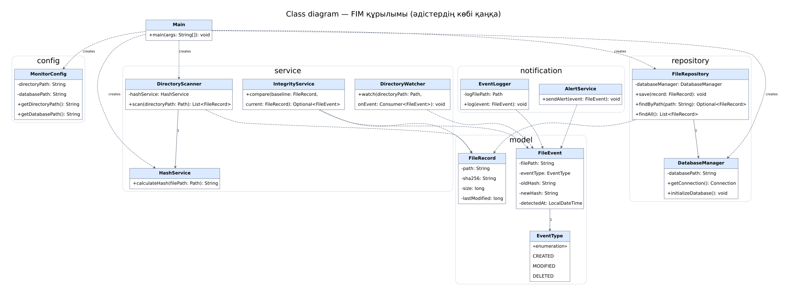
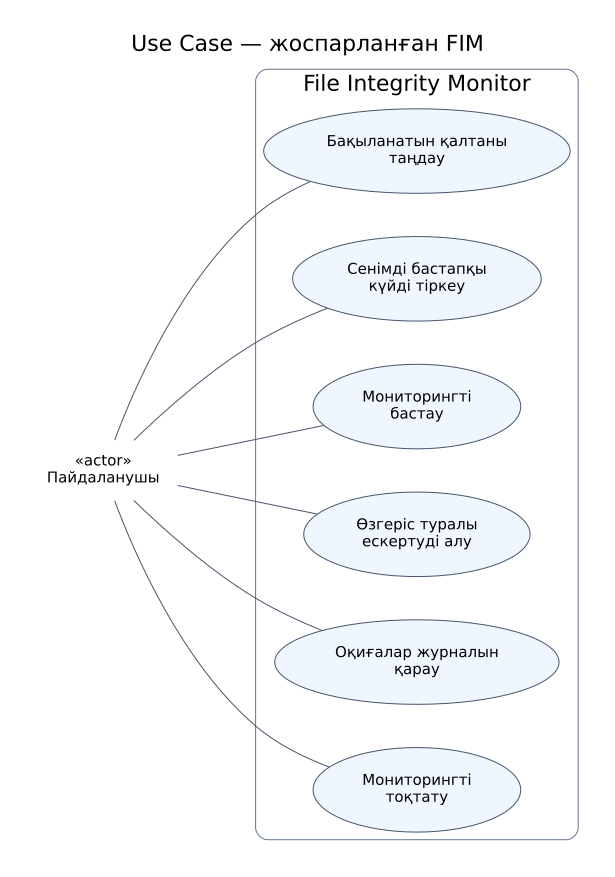
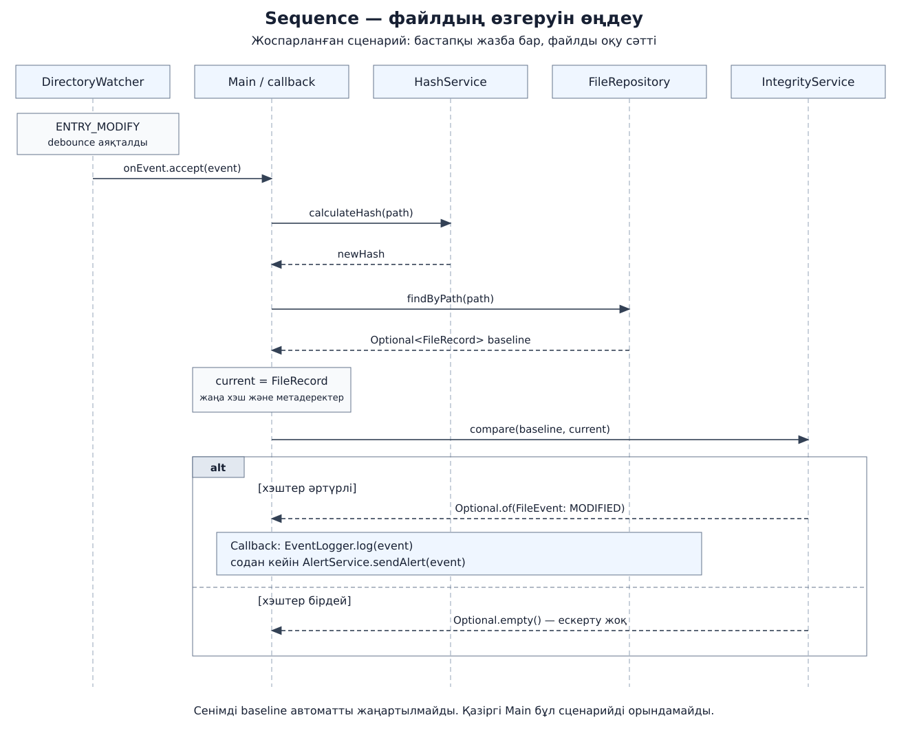

# UML түсіндірмесі

Бұл үш диаграмма екінші аптадағы құрылымға және бірінші аптаның research жоспарына негізделген. Толық соңғы Java коды берілмегендіктен, олар толық код аудитін алмастырмайды.

## 1 Class diagram

Кластардың міндеттері мен байланыстары көрсетілген. `+` — public, `-` — private. Тұтас бағытталған сызық — объектіге сақталатын сілтеме; үзік бағытталған сызық — пайдалану немесе тәуелділік. Мұрагерлік көрсетілмеген, себебі осы құрылымда кластар арасында мұрагерлік жоқ. `1` — бір сілтеме. Құрамдастықты білдіретін қара ромб қолданылмады: конструктордан берілген объектінің өмірлік циклін класс өзі басқаратыны дәлелденбеген.

Диаграммада негізгі өрістер мен бизнес-әдістер берілген; конструкторлар мен геттерлердің бәрі көрсетілмейді. `Main` ішіндегі жасалу байланыстары мен сервистің орындалған логикасы бір нәрсе емес. Сервис әдістерінің көбі әзірге қаңқа.

Бастапқы файл: [class.dot](class.dot). Graphviz DOT форматында өңделеді.

## 2 Use Case diagram

Актер — пайдаланушы. Тікбұрыш — FIM жүйесінің шекарасы, сопақтар — қолдану жағдайлары. Бұл диаграмма **жоспарланған толық нұсқаға** арналған: қалтаны таңдау, сенімді бастапқы күйді тіркеу, мониторингті бастау, ескертуді алу, журналды қарау және бақылауды тоқтату. Журналды қарау әзірге бөлек графикалық интерфейс емес, журнал файлын ашып оқу ретінде жоспарланған.

Бастапқы файл: [use-case.dot](use-case.dot). Graphviz DOT форматында өңделеді.

## 3 Sequence diagram

Жоғарыдан төмен қарай уақыт өтеді. Үзік тік сызықтар — қатысушылардың өмір сызықтары; тұтас жебе — шақыру; үзік жебе — қайтарылатын нәтиже. `alt` — шарт бойынша тармақталу.

Мұнда тек **бұрыннан бар файлдың өзгеруі** қарастырылады. Бастапқы жазба бар, файлды оқу сәтті, debounce аяқталған деп алынады. DirectoryWatcher оқиғаны Main берген callback-ке жеткізеді. Main HashService, FileRepository және IntegrityService арқылы жаңа күйді салыстырады. Өзгеріс расталса, callback журнал мен ескерту қызметін шақырады; хэш өзгермесе, ескерту шықпайды.

Журнал мен ескерту негізгі бес қатысушыға қосымша мәтіндік блокта көрсетілді. Бұл — ұсынылған біріктіру сценарийі, қазіргі Main-де іске асырылған әрекеттер емес. CREATE, DELETE, OVERFLOW және қате өңдеу сценарийлері бұл диаграмманың шегіне кірмейді. Сенімді baseline автоматты жаңартылмайды.

Бастапқы файл: [sequence.svg](sequence.svg) — өңделетін векторлық SVG.

## Қорғауда қысқаша айту

«Class диаграммасы бағдарламаның неден тұратынын, Use Case пайдаланушының не істей алатынын, ал Sequence компоненттердің қандай ретпен әрекет ететінін көрсетеді. Қазір құрылым дайын; Use Case және Sequence толық бағдарламаның жоспарланған жұмысын сипаттайды».
